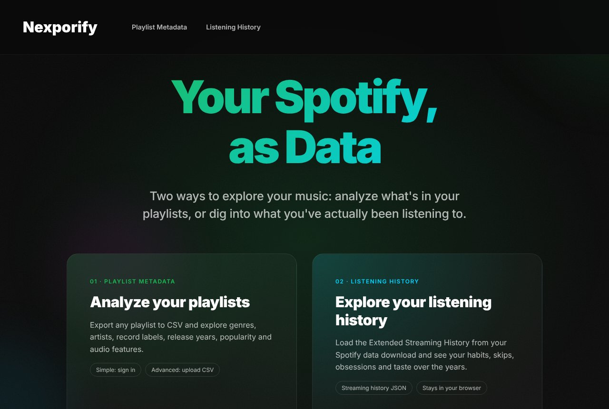
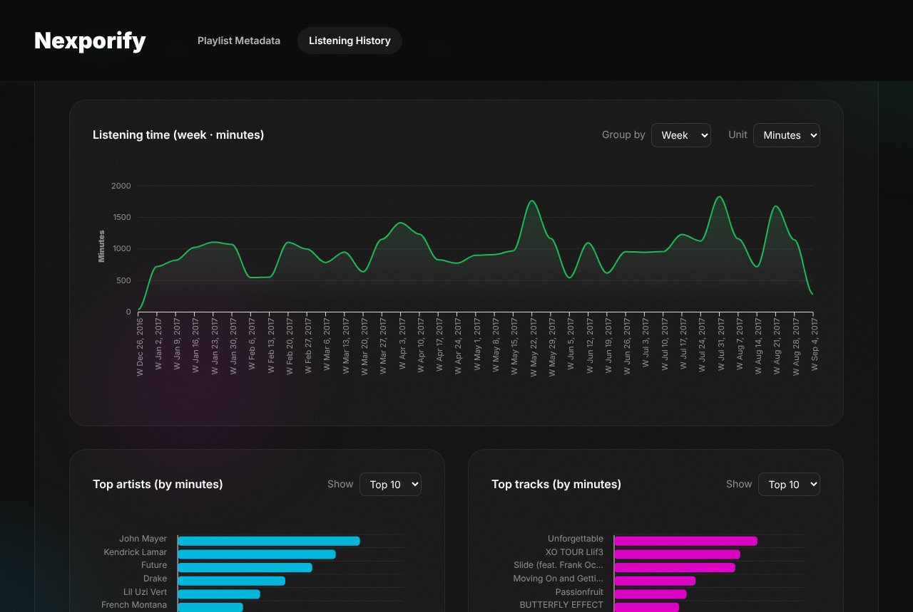

[](https://github.com/visheshvs/nexportify/actions/workflows/deploy.yml)
[](https://mybinder.org/v2/gh/visheshvs/nexportify/master)

# Nexporify

**Your Spotify, as data.** Nexporify is an open-source fork of [Exportify](https://exportify.net) with a redesigned interface and two ways to explore your music:

1. **Spotify Playlist Metadata**: export any playlist to CSV and analyze its genres, artists, record labels, release years, popularity and audio features.
2. **Listening Data Exploration**: load the Extended Streaming History from your Spotify data download and explore years of plays: habits, taste, skips and obsessions.

🌐 **Live site**: [visheshvs.github.io/nexportify](https://visheshvs.github.io/nexportify/)



## 1. Spotify Playlist Metadata

Pick the mode that fits:

| | Simple Analysis | Advanced Analysis |
|---|---|---|
| **How** | Sign in with Spotify on the home page | Upload a CSV exported from [exportify.net](https://exportify.net) |
| **You get** | Genres, artists, record labels, release years, popularity, duration | Everything in Simple, plus audio features: mood quadrant (energy × valence), tempo, key, danceability, acousticness and more |
| **Also** | Browse, search and sort your playlists (card or list view), including **Liked Songs** and **Saved Albums**; export one playlist as CSV or all of them as a ZIP | No sign-in needed; the file is analyzed in your browser |

Each analysis opens in a new tab with interactive charts (ApexCharts), top-10 lists and a sortable, filterable track table.

### CSV export format

Exported CSVs have these columns:

- [Track URI](https://developer.spotify.com/documentation/web-api/concepts/spotify-uris-ids)
- [ISRC](https://en.wikipedia.org/wiki/International_Standard_Recording_Code)
- Track Name, Album Name, Artist Name(s) (multiple artists separated by `;`)
- Release Date, Duration (ms), Popularity, Explicit
- Added By, Added At
- Genres, Record Label
- Danceability, Energy, Key, Loudness, Mode, Speechiness, Acousticness, Instrumentalness, Liveness, Valence, Tempo, Time Signature

### Spotify API limits to know about

This site runs on a Spotify app in **Development Mode**, and Spotify has restricted what such apps can do:

- **Who can sign in**: only users the app owner has added under *User Management* in the [Spotify Developer Dashboard](https://developer.spotify.com/dashboard), and the owner needs Spotify Premium. Anyone else sees an explanation and can still use Advanced Analysis.
- **Audio features**: Spotify stopped serving them to apps created after November 2024, so in Simple Analysis those CSV columns are blank. Use Advanced Analysis (an exportify.net CSV) for them.
- **February 2026 changes**: playlist contents moved from `tracks` to `items`, and bulk lookups (several artists, albums or tracks at once) were removed. Nexporify handles both API shapes and falls back to one request per item when a bulk lookup is refused, so genres and labels still come through (more slowly on big playlists). Contents of playlists you don't own or collaborate on are no longer available.

See the [Feb 2026 changelog](https://developer.spotify.com/documentation/web-api/references/changes/february-2026) and [migration guide](https://developer.spotify.com/documentation/web-api/tutorials/february-2026-migration-guide).

## 2. Listening Data Exploration



[`spotify-data.html`](https://visheshvs.github.io/nexportify/spotify-data.html) reads Spotify's **Extended Streaming History** (`Streaming_History_Audio_*.json` / `Streaming_History_Video_*.json`). Everything is processed in your browser; nothing is uploaded, and IP addresses in the raw files are never charted or exported.

**Getting your data:** open [spotify.com/account/privacy](https://www.spotify.com/account/privacy/) in a web browser, request **Extended streaming history** under *Download your data*, confirm the email, and wait for the download link (up to about 30 days). Unzip it and upload the JSON files; several files at once is fine.

**What you can explore:**

- **Overview**: listening time by day, week, month or year; top artists and tracks; content type, platforms and why streams ended; a searchable library summary and the full play log
- **Fingerprint**: a weekday × hour listening clock, daily calendar, streaks and session lengths
- **Taste**: how concentrated your listening is (Lorenz curve, Gini), new artists and tracks discovered each month, novelty ratio
- **Artists**: loyal artists vs short "flings" (the loyalty threshold scales with the period your data covers), artist timelines, catalog depth, one-track obsessions
- **Attention**: completion rates, skip rate by platform, hour and artist, how plays started
- **Obsessions**: longest on-repeat streaks, peak plays in a single day, comeback tracks (only plays of 30 seconds or more count)
- **Context**: countries, devices and offline listening over time

Filter by date, content type, platform, medium and time zone, optionally exclude skips, and export the result to Excel. Platform strings are shown as readable device names (e.g. "Android tablet · OnePlus A3003"); the raw value is kept in the play log and the Excel export.

## Jupyter notebook

[`taste_analysis.ipynb`](taste_analysis.ipynb) (from the original Exportify) plots common artists and genres, release-date and popularity distributions, audio-feature distributions, keys and time signatures, and a 2D map of song similarity. Run it locally with `python3 -m notebook` or [launch it in Binder](https://mybinder.org/v2/gh/visheshvs/nexportify/master).

## Project structure

```
index.html              Home page: both features, sign-in, playlist browser, CSV upload
exportify.js            Spotify auth (PKCE), API calls, CSV export, Simple/Advanced report pages
spotify-data.html       Listening Data Exploration page
spotify-data.js         Streaming-history parsing, filters, Overview charts, Excel export
spotify-insights.js     Fingerprint / Taste / Artists / Attention / Obsessions / Context insights
nav.js                  Smooth in-page navigation for the header, logo and hero links
styles/artistic-theme.css   Design system (dark theme, layout, components)
test-analysis.html      Preview of the analysis page design with sample data
taste_analysis.ipynb    Jupyter analysis notebook
screenshots/            Images used in this README
```

The site is static HTML/JS with no build step. React 16, ApexCharts, SheetJS (xlsx) and JSZip load from CDNs.

## Running locally

```bash
python3 -m http.server 8000
```

Then open [http://127.0.0.1:8000](http://127.0.0.1:8000). Advanced Analysis and Listening Data Exploration work right away. To test Spotify sign-in, add `http://127.0.0.1:8000` as a Redirect URI for your app in the Spotify Developer Dashboard. Spotify no longer accepts `localhost` redirect URIs, so use `127.0.0.1`. The app uses the page's own address (minus any trailing `/` or `index.html`) as the redirect URI, so it must match exactly.

To use your own Spotify app, replace the `client_id` in `exportify.js`.

## Deployment

Pushing to `master` runs [`.github/workflows/deploy.yml`](.github/workflows/deploy.yml), which builds the notebook HTML and publishes the repository to GitHub Pages. The Spotify app must list `https://visheshvs.github.io/nexportify` (no trailing slash) as a Redirect URI.

See [SETUP_GUIDE.md](SETUP_GUIDE.md) for more on local setup and Spotify credentials.

## Contributing

1. Create a feature branch: `git checkout -b my-change`
2. Commit and push it
3. Open a pull request **into `visheshvs/nexportify`**

Because this repo is a fork, GitHub may pre-select the original `pavelkomarov/exportify` as the base repository. Check that the base reads `visheshvs/nexportify`, or start from [github.com/visheshvs/nexportify/compare](https://github.com/visheshvs/nexportify/compare).

## Credits

Made by [@visheshvs](https://www.visheshvs.com/). Based on [Exportify](https://github.com/pavelkomarov/exportify) by Pavel Komarov, used under the [MIT License](LICENSE).
